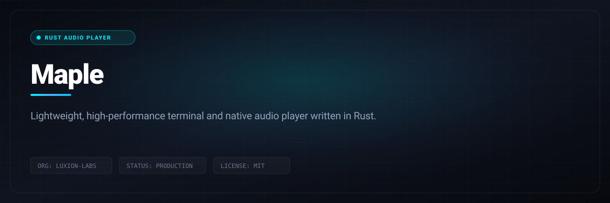

# Maple

> A native desktop YouTube Music client: Rust + Tauri, ad-free, no Electron.



<p align="center">
  
  &nbsp;
  
  &nbsp;
  
  &nbsp;
  
  &nbsp;
  
  &nbsp;
  
</p>

<p align="center">
  <a href="https://github.com/Luxion-Labs/maple-music/releases/latest"></a>
  &nbsp;
  <a href="LICENSE"></a>
  &nbsp;
  <a href="CONTRIBUTING.md"></a>
</p>

---

## Quick Start & Getting Started

Getting Maple built locally requires the standard Rust and Node toolchains:

```bash
git clone https://github.com/Luxion-Labs/maple-music.git
cd maple-music
cargo tauri dev
```

To create standalone release binaries:
```bash
cargo tauri build
```

---

Features

- **Ad-free playback**  -  streams come straight from YouTube's API, ads never do
- **Search & browse**  -  songs, albums, artists, playlists, and the YTM home feed
- **Sign in** with your YouTube Music account: in-app Google login or cookie-paste
- **Your library**  -  playlists, liked songs, and write actions (like, add to playlist, create/rename/delete playlists, subscribe)
- **Gapless playback** with loudness normalization, powered by libmpv
- **Queue** with radio/automix continuation, restored across restarts
- **Synced lyrics**  -  line-by-line side panel with auto-scroll and click-to-jump
- **Mini Player**  -  Minimize the player and keep enjoying your music
- **Local Music**  -  ability to play your own local music, with all metadata still intact
- **Last.fm scrobbling**  -  connect once from the title bar, every play is scrobbled
- **Discord Rich Presence**  -  artwork, live progress bar, one click to toggle
- **OS media keys** and now-playing integration (MPRIS on Linux, SMTC on Windows)
- **System tray**  -  close the window, keep the music; play/pause and skip from the tray, optional start-on-login
- **Listen Together**  -  synced listening rooms over a small self-hosted relay
- **Self-updating builds** (AppImage on Linux, setup.exe on Windows)
- **Customization via Themes and Fonts**  -  Customize your music player to your hearts content

---

<h2 align="center">Download & Install</h2>

<p align="center">
  <a href="https://github.com/Luxion-Labs/maple-music/releases/latest">
    
  </a>
</p>

| Platform | File | Notes |
|---|---|---|
| Linux | `.AppImage` | Self-updating, libmpv bundled. Needs glibc 2.39+ (Ubuntu 24.04+, Debian 13+, Fedora 40+) |
| Linux (Fedora/RHEL) | `.rpm` | Needs `mpv-libs` installed (`sudo dnf install mpv-libs`) |
| Windows | `-setup.exe` | Self-updating |
| Windows | `.msi` | Plain installer, no auto-update |
| macOS | none yet | Build from source, see [docs/BUILD-PLATFORMS.md](docs/BUILD-PLATFORMS.md) |

---

## Scrobbling & Discord

Both live in the title bar, next to the window controls.

- **Last.fm**  -  click the Last.fm mark, approve Maple in the browser tab that
  opens, and you're connected for good. Tracks scrobble at the halfway point (or
  four minutes, whichever comes first), which is Last.fm's own rule. Click again
  to see the account or disconnect.
- **Discord**  -  click the Discord mark to toggle Rich Presence. Green dot means
  it's live. The card shows the track, artist, album art, and a progress bar, and
  it disappears when you pause.

Building from source? Last.fm needs your own API credentials  -  they're not in the
repo. Get a key at [last.fm/api/account/create](https://www.last.fm/api/account/create)
and put it in `src-tauri/lastfm.keys`:

```
MAPLE_LASTFM_API_KEY=your_key
MAPLE_LASTFM_API_SECRET=your_secret
```

Without that file everything else still builds and runs; the Last.fm button just
reports that it isn't configured.

---

## Lyrics

Open the panel with the microphone button in the player bar, next to the queue
button. It takes the same side of the window as the queue, so opening one closes
the other.

Lyrics come from [Boidu](https://boidu.dev) first, then
[LRCLIB](https://lrclib.net), then YouTube Music's own timed lyrics, then
Netease, QQ Music and Kugou, falling back to plain un-timed text when nobody has
a synced version. Matching is keyed on the track's exact length, because popular
songs exist as several cuts and the wrong one drifts a few seconds out. Results
are cached locally, so replaying a track is instant.

Boidu is the only source with per-word timings, which is what lets a line
highlight word by word as it's sung. It goes first for that reason, which also
means it is asked about every track you play. Turn it off in **Settings ->
Playback -> Word-by-word lyrics** and the other sources still provide
line-by-line lyrics. Netease additionally supplies translations, shown under
each line where it has them.

Note that YouTube Music's lyrics are licensed per region and are missing
entirely in some countries  -  where that's the case, LRCLIB does all the work.

---

## Listen Together

Synced listening with friends. Everyone streams their own audio from YouTube;
the room only relays play/pause, seeks, track changes and the queue. One person
hosts the relay:

```bash
cargo run -p sync-server        # plain WebSocket on 0.0.0.0:8080
```

Front it with something that terminates TLS (Tailscale Funnel, Cloudflare
Tunnel), then paste the `wss://` URL into the Listen Together panel in the app.
Rooms have join codes and the host approves every join and every track
suggestion.

---

## Building from Source

Fedora:

```bash
sudo dnf install mpv-libs mpv-libs-devel webkit2gtk4.1-devel \
  gcc gcc-c++ make openssl-devel librsvg2-devel
cd ui && pnpm install && cd ..
cargo tauri build
```

Windows and macOS instructions live in [docs/BUILD-PLATFORMS.md](docs/BUILD-PLATFORMS.md).

---

## How It Works, Briefly

- A pure Rust crate speaks YouTube's InnerTube API, impersonating several
  official client identities and falling back between them when one fails.
- YouTube's stream URLs are protected by obfuscated JavaScript (the signature
  cipher and the `n` parameter) and by BotGuard attestation. Maple runs that
  JavaScript where it expects to run, in a real webview, hidden, and never lets
  any of it touch the UI process.
- Audio goes through libmpv: gapless transitions, an on-disk cache, and
  loudness normalization from YouTube's own metadata.
- The UI is a SvelteKit SPA that only ever talks to the Rust core. It never
  contacts YouTube itself.

---

## Disclaimer

This project is not affiliated with, funded, authorized, endorsed by, or in
any way associated with YouTube, Google LLC, or any of their affiliates and
subsidiaries.

All trademarks, service marks, and intellectual property rights referenced in
this project belong to their respective owners.

---

## Maintainer Response SLA
Luxion Labs enforces a strict 24-hour response SLA on all community issues, feature proposals, and pull requests. See [CONTRIBUTING.md](CONTRIBUTING.md) for full development guidelines.